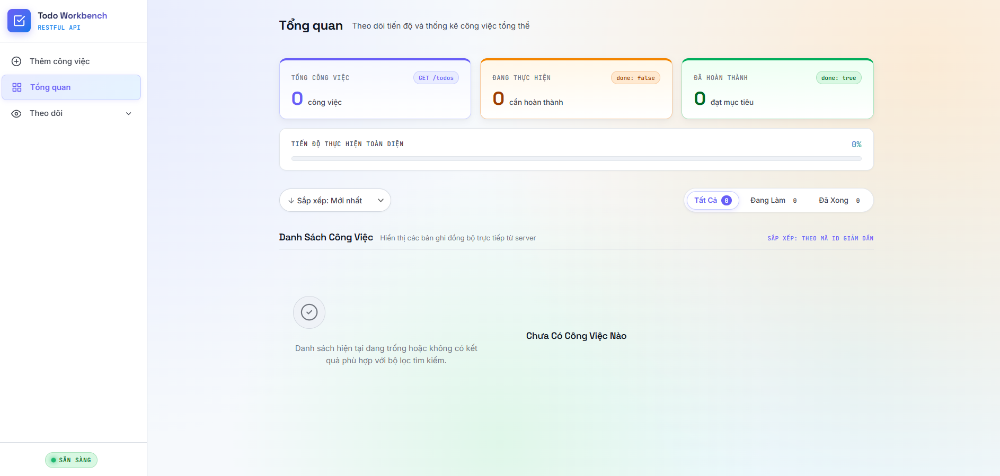

# 📋 Todo API & Management Workbench

Ứng dụng quản lý công việc và tác vụ hàng ngày fullstack, kết hợp giữa **RESTful API** xây dựng bằng **Express.js** và giao diện web người dùng trực quan, hiện đại bằng **Vanilla JavaScript / CSS**.



---

## 🚀 Tính năng nổi bật

### 1. Backend RESTful API
- **CRUD đầy đủ**: Tạo mới, xem danh sách, xem chi tiết, cập nhật (patch) và xóa công việc.
- **Lưu trữ tệp cục bộ (File Persistence)**: Tự động lưu và đồng bộ dữ liệu vào tệp `data/todos.json`.
- **Middleware kiểm soát**:
  - `log`: Tự động ghi lại `method` và `URL` của các request tới server.
  - `checkTitle`: Xác thực dữ liệu đầu vào bắt buộc khi tạo công việc mới.
  - Phục vụ tệp tĩnh (Static files) từ thư mục `public/`.

### 2. Frontend Web Interface
- **Bảng điều khiển & Thống kê**: Theo dõi trực quan tổng số việc, số việc đang chờ và số việc đã hoàn thành.
- **Bộ lọc & Sắp xếp linh hoạt**: Lọc công việc theo trạng thái (Tất cả, Đang làm, Hoàn thành), lọc theo chủ đề và sắp xếp theo deadline/thời gian.
- **Trải nghiệm mượt mà**: Hỗ trợ chuyển đổi giao diện Sáng / Tối (Light / Dark theme), thông báo dạng Toast, Modal thao tác công việc nhanh chóng.

---

## 🛠️ Công nghệ sử dụng

- **Backend**: [Node.js](https://nodejs.org/), [Express.js](https://expressjs.com/) (v5.x)
- **Frontend**: HTML5, Modern CSS3, JavaScript (ES6+)
- **Lưu trữ**: JSON Database (`data/todos.json`)
- **Typography**: Space Grotesk, Inter, JetBrains Mono

---

## 📁 Cấu trúc thư mục

```text
toDoApi/
├── data/
│   └── todos.json          # Tệp lưu trữ dữ liệu công việc dạng JSON
├── public/                 # Giao diện người dùng (Frontend)
│   ├── app.js              # Xử lý logic giao diện, gọi API và cập nhật DOM
│   ├── index.html          # Khung trang web chính
│   └── style.css           # Định dạng giao diện (Theme, Layout, Components)
├── routes/
│   └── todoRoutes.js       # Định nghĩa các endpoint RESTful API cho /todos
├── Drraft-UI/              # Thư mục bản vẽ nháp giao diện (tham khảo)
├── package.json            # Thông tin dự án và danh sách dependencies
├── server.js               # Khởi chạy Express server và cấu hình middleware
└── README.md               # Tài liệu hướng dẫn sử dụng dự án
```

---

## ⚡ Hướng dẫn cài đặt & Khởi chạy

### 1. Yêu cầu hệ thống
- Máy tính đã cài đặt **Node.js** (khuyến nghị phiên bản 18 trở lên) và **npm**.

### 2. Cài đặt dependencies
Mở terminal tại thư mục gốc của dự án và chạy lệnh:
```bash
npm install
```

### 3. Khởi chạy ứng dụng
Chạy lệnh sau để khởi động máy chủ:
```bash
npm start
```
*Hoặc khởi chạy trực tiếp bằng Node:*
```bash
node server.js
```

Khi máy chủ khởi động thành công, bạn sẽ thấy thông báo:
```text
Chạy tại http://localhost:3000
```

### 4. Sử dụng
- Mở trình duyệt web và truy cập vào: [http://localhost:3000](http://localhost:3000) để sử dụng giao diện quản lý.
- Gửi các HTTP request tới API theo địa chỉ: `http://localhost:3000/todos`.

---

## 📡 Tài liệu RESTful API

Base URL: `http://localhost:3000/todos`

| Phương thức | Đường dẫn | Mô tả | Mã phản hồi |
| :--- | :--- | :--- | :--- |
| `GET` | `/todos` | Lấy danh sách tất cả công việc | `200 OK` |
| `GET` | `/todos/:id` | Lấy thông tin chi tiết một công việc theo ID | `200 OK` / `404 Not Found` |
| `POST` | `/todos` | Tạo mới một công việc | `201 Created` / `400 Bad Request` |
| `PATCH` | `/todos/:id` | Cập nhật thông tin công việc theo ID | `200 OK` / `404 Not Found` |
| `DELETE` | `/todos/:id` | Xóa một công việc theo ID | `200 OK` / `404 Not Found` |

---

### Chi tiết các Endpoint

#### 1. Lấy danh sách công việc
- **URL**: `GET /todos`
- **Response** (`200 OK`):
  ```json
  [
    {
      "id": 1,
      "title": "Học Node.js & Express",
      "description": "Thực hành xây dựng RESTful API",
      "topic": "Học tập",
      "deadline": "2026-10-25",
      "time": "20:00",
      "done": false
    }
  ]
  ```

#### 2. Lấy chi tiết công việc theo ID
- **URL**: `GET /todos/:id`
- **Ví dụ**: `GET /todos/1`
- **Response thành công** (`200 OK`):
  ```json
  {
    "id": 1,
    "title": "Học Node.js & Express",
    "description": "Thực hành xây dựng RESTful API",
    "topic": "Học tập",
    "deadline": "2026-10-25",
    "time": "20:00",
    "done": false
  }
  ```
- **Response thất bại** (`404 Not Found`):
  ```json
  {
    "error": "Not found"
  }
  ```

#### 3. Tạo công việc mới
- **URL**: `POST /todos`
- **Headers**: `Content-Type: application/json`
- **Request Body**:
  ```json
  {
    "title": "Chuẩn bị bài thuyết trình",
    "description": "Hoàn thiện slide và kịch bản thuyết trình",
    "topic": "Công việc",
    "deadline": "2026-10-30",
    "time": "09:00",
    "done": false
  }
  ```
  *(Lưu ý: Trường `title` là bắt buộc. Nếu thiếu sẽ trả về lỗi `400 Bad Request`)*.
- **Response thành công** (`201 Created`):
  ```json
  {
    "id": 2,
    "title": "Chuẩn bị bài thuyết trình",
    "description": "Hoàn thiện slide và kịch bản thuyết trình",
    "topic": "Công việc",
    "deadline": "2026-10-30",
    "time": "09:00",
    "done": false
  }
  ```

#### 4. Cập nhật công việc (Partial Update)
- **URL**: `PATCH /todos/:id`
- **Headers**: `Content-Type: application/json`
- **Request Body** *(chỉ cần gửi các trường muốn cập nhật)*:
  ```json
  {
    "done": true
  }
  ```
- **Response thành công** (`200 OK`):
  ```json
  {
    "id": 1,
    "title": "Học Node.js & Express",
    "description": "Thực hành xây dựng RESTful API",
    "topic": "Học tập",
    "deadline": "2026-10-25",
    "time": "20:00",
    "done": true
  }
  ```

#### 5. Xóa công việc
- **URL**: `DELETE /todos/:id`
- **Ví dụ**: `DELETE /todos/1`
- **Response thành công** (`200 OK`): Không có body trả về (`res.status(200).end()`).
- **Response thất bại** (`404 Not Found`):
  ```json
  {
    "error": "Not Found"
  }
  ```

---

## 📝 Cấu trúc dữ liệu Todo Object

Mỗi đối tượng Todo được lưu trữ với định dạng:

```typescript
{
  id: number;           // Khóa chính tự động tăng
  title: string;        // Tiêu đề công việc (bắt buộc)
  description?: string;  // Mô tả chi tiết
  topic?: string;        // Chủ đề / Danh mục (Ví dụ: Học tập, Công việc, ...)
  deadline?: string;     // Ngày đến hạn (Định dạng YYYY-MM-DD)
  time?: string;         // Giờ đến hạn (Định dạng HH:mm)
  done: boolean;        // Trạng thái hoàn thành (mặc định: false)
}
```